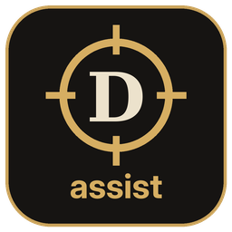
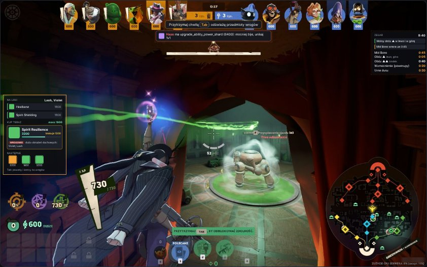
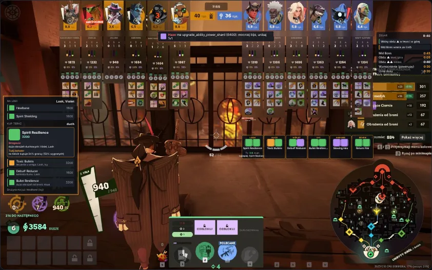
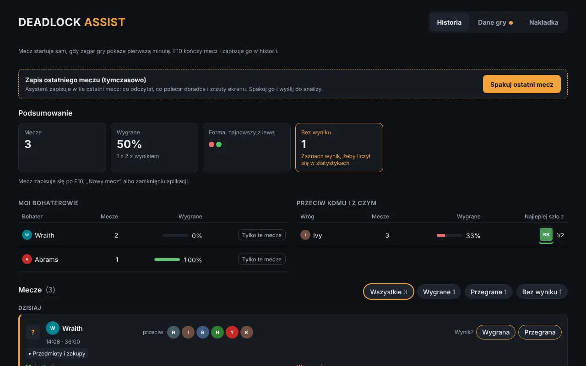

# Deadlock Assist

**Doradca do Deadlocka, który podpowiada w trakcie meczu, co kupić, i zapisuje Twoją historię gier.**

[Strona projektu](https://deadlock-assist.com/) · [English](https://deadlock-assist.com/en/)

## Co robi

- **Kontry pod skład wroga.** Rozpoznaje bohaterów z górnego paska i podpowiada przedmioty, które najlepiej działają na nich, z cenami i tym, na co Cię stać.
- **„Kup teraz” i następne zakupy.** Plan buildu oparty na statystykach z tysięcy meczów (deadlock-api), dopasowany do tego, co już masz.
- **Zakupy wrogów.** Po wciśnięciu Tab zapamiętuje przedmioty przeciwników i ostrzega, gdy ktoś kupi np. leczenie.
- **Zegar i timery.** Mid Boss, obozy w dżungli, wzmocnienia i urna dusz.
- **Historia meczów.** Wyniki, farma minuta po minucie, kolejność zakupów i podsumowanie z tym, co poprawić.
- **Działa sama.** Mecz startuje, gdy zegar gry pokaże pierwszą minutę; aplikacja aktualizuje się sama.

  
  

## Instalacja

1. Pobierz `Deadlock.Assist_x.y.z_x64-setup.exe` z [najnowszego wydania](https://github.com/adam2s/deadlock-assist-releases/releases/latest).
2. Uruchom instalator. Jeśli Windows pokaże „System Windows ochronił ten komputer”, kliknij **Więcej informacji → Uruchom mimo to** (instalator nie ma jeszcze płatnego podpisu cyfrowego).
3. Włącz Deadlocka w trybie **okna bez ramek** (Borderless), żeby nakładka była widoczna nad grą.

Kolejne wersje instalują się z poziomu aplikacji: przy nowej wersji pojawi się przycisk „Zaktualizuj i uruchom ponownie”.

| Skrót | Działanie |
| --- | --- |
| `F10` | koniec meczu i zapis w historii |
| `Tab` (przytrzymany) | odświeżenie przedmiotów wszystkich graczy |

## Bezpieczeństwo

Deadlock Assist **nie czyta pamięci gry, nie modyfikuje jej plików i nie wysyła do niej żadnych klawiszy**. Robi tylko zrzuty ekranu (tak jak OBS czy Discord) i pobiera publiczne statystyki z [deadlock-api.com](https://deadlock-api.com). Zrzuty zostają na Twoim komputerze i są usuwane po zapisaniu meczu.

To nieoficjalne narzędzie fanów, niezwiązane z Valve. Valve nie publikuje listy dozwolonych programów zewnętrznych, więc korzystasz z niego na własną odpowiedzialność.

## Pomysły i błędy

- Masz pomysł? Kliknij **„Zaproponuj zmianę”** w aplikacji albo [zgłoś go tutaj](https://github.com/adam2s/deadlock-assist-releases/issues/new?template=pomysl.yml).
- Coś nie działa? [Zgłoś błąd](https://github.com/adam2s/deadlock-assist-releases/issues/new?template=blad.yml), najlepiej ze zrzutem ekranu.

## Wsparcie

Aplikacja jest i zostanie darmowa. Jeśli pomaga Ci wygrywać, możesz postawić autorowi kawę na **[ko-fi.com/deadlockassist](https://ko-fi.com/deadlockassist)** albo przyciskiem **„☕ Wesprzyj”** w prawym górnym rogu aplikacji.

---

Deadlock jest znakiem towarowym Valve Corporation. Ten projekt nie jest powiązany z Valve ani przez nią wspierany. Dane o przedmiotach i bohaterach pochodzą z <a href="https://deadlock-api.com">deadlock-api.com</a>.
